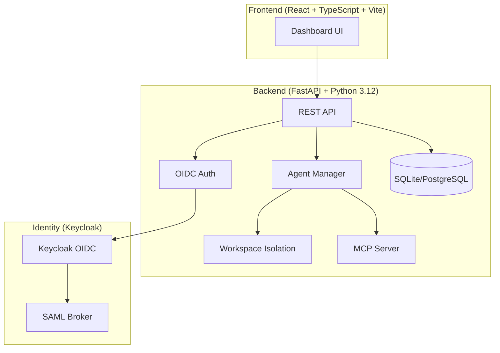

# Cobalt Engine

> Work in progress. This checkpoint may be incomplete or fail tests. See PLAN.md and STATUS.md before use.


**Ryan Vo | AI & Machine Learning**

A smarter, self-hosted AI assistant — multi-user, multi-agent.

## Overview

Cobalt Engine is a self-hosted AI assistant platform designed for developers and researchers working with AI agents. It provides:

- **Strict Workspace Isolation**: Each agent operates within its own sandboxed workspace directory, preventing cross-agent data leakage (addresses upstream Issue #1160)
- **MCP Server Exposure**: Expose agent memory and tools via Model Context Protocol for external AI consumption (addresses upstream Issue #322)
- **Multi-User Support**: Admin-preconfigured specialist agents with complete user data/workspace isolation (addresses upstream Issue #2207)
- **OIDC/Keycloak Authentication**: Enterprise-grade authentication with SAML identity broker support

## AI/ML Focus

Cobalt Engine is built for **agent reasoning and evaluation**, **model quality assessment**, and **learning from data**. The platform enables:

- Running multiple AI agents with isolated workspaces for reproducible experiments
- Evaluating agent behavior across different models and configurations
- Exposing agent memory via MCP for integration with external evaluation tools
- Tracking agent performance metrics and audit logs

## Architecture



## Quick Start

### Prerequisites

- Docker and Docker Compose
- Node.js 24+ (for local frontend development)
- Python 3.12+ (for local backend development)

### Using Docker Compose (Recommended)

```bash
# Clone the repository
git clone https://github.com/A220man/cobalt-engine-ryan-vo.git
cd cobalt-engine-ryan-vo

# Copy environment template
cp .env.example .env

# Edit .env with your configuration
# Required for production: KEYCLOAK_CLIENT_SECRET, LLM_API_KEY

# Start all services
docker compose up -d

# Access the application
# Frontend: http://localhost:5173
# Backend API: http://localhost:8000
# API Docs: http://localhost:8000/docs
# Keycloak: http://localhost:8080 (admin/admin)
```

### Local Development

#### Backend

```bash
cd backend
python -m venv .venv
source .venv/bin/activate
pip install -r requirements.txt
cp ../.env.example .env
# Edit .env as needed
DEMO_MODE=true uvicorn app.main:app --reload --host 0.0.0.0 --port 8000
```

#### Frontend

```bash
cd frontend
npm install
npm run dev
```

## Configuration

### Environment Variables

| Variable | Description | Default |
|----------|-------------|---------|
| `APP_ENV` | Environment (development/production) | `development` |
| `DATABASE_URL` | SQLAlchemy database URL | `sqlite:///./data/cobalt.db` |
| `SECRET_KEY` | Application secret key | Required in production |
| `LLM_API_KEY` | LLM provider API key | Optional |
| `LLM_PROVIDER` | LLM provider (openai-compatible, anthropic, gemini, ollama) | `openai-compatible` |
| `LLM_MODEL` | Model name | `gpt-4o-mini` |
| `LLM_BASE_URL` | Provider base URL | `https://api.openai.com/v1` |
| `KEYCLOAK_URL` | Keycloak server URL | `http://localhost:8080` |
| `KEYCLOAK_REALM` | Keycloak realm | `cobalt` |
| `KEYCLOAK_CLIENT_ID` | Keycloak client ID | `cobalt-engine` |
| `KEYCLOAK_CLIENT_SECRET` | Keycloak client secret | Required in production |
| `DEMO_MODE` | Enable demo mode (localhost only) | `false` |

### LLM Provider Configuration

Cobalt Engine supports multiple LLM providers through a unified interface:

- **OpenAI-compatible**: OpenAI, LiteLLM, OpenRouter, Ollama (OpenAI-compatible endpoint)
- **Anthropic**: Claude models via Anthropic Messages API
- **Gemini**: Google Gemini via generateContent API
- **Ollama**: Local models via Ollama API

All LLM credentials are server-side only. The operator configures the provider, model, and endpoint via environment variables. No credentials are exposed to the frontend.

### Keycloak/SAML Setup

1. Start Keycloak via Docker Compose (imports `cobalt` realm automatically)
2. Configure SAML identity providers in Keycloak Admin Console
3. Map SAML attributes to Keycloak roles (viewer, operator, admin)
4. Update `KEYCLOAK_CLIENT_SECRET` in `.env` with the generated secret

**Demo Mode**: For local development only, set `DEMO_MODE=true`. This creates a local admin user without Keycloak. **Production deployments MUST set `DEMO_MODE=false` and configure Keycloak.**

## API Reference

### Health Check

```
GET /api/health
Response: {"status": "ok", "version": "1.0.0"}
```

### Workspaces

```
GET    /api/workspaces              # List workspaces
POST   /api/workspaces              # Create workspace
GET    /api/workspaces/{id}         # Get workspace
DELETE /api/workspaces/{id}         # Delete workspace
```

### Agents

```
GET    /api/agents                  # List agents (filter: workspace_id)
POST   /api/agents                  # Create agent
GET    /api/agents/{id}             # Get agent
PATCH  /api/agents/{id}             # Update agent
DELETE /api/agents/{id}             # Delete agent
```

### Users

```
GET /api/users/me                   # Current user info
GET /api/users                      # List users (admin only)
GET /api/users/{id}                 # Get user (admin only)
```

All data endpoints require authentication via Bearer token (Keycloak OIDC).

## AI/ML Evaluation

Cobalt Engine includes a reproducible evaluation framework for agent performance:

### Running Evaluations

```bash
# Backend evaluation script (to be implemented)
cd backend
python -m eval.run --agent-id 1 --benchmark gsm8k --runs 10
```

### Evaluation Metrics

- **Task Success Rate**: Percentage of completed tasks
- **Token Efficiency**: Tokens used per successful task
- **Latency**: Response time distribution
- **Error Rate**: Failed executions / total executions

### Baseline Results

*To be populated after implementation of evaluation engine.*

### Failure Cases

- Agent workspace isolation violations (tracked via audit log)
- LLM provider failures (circuit breaker pattern)
- Concurrent agent execution conflicts

## Security

- All API endpoints require valid OIDC token
- Role-based access control (viewer, operator, admin)
- Workspace isolation enforced at filesystem and database level
- No hardcoded secrets or credentials
- Demo mode explicitly opt-in and localhost-bound
- TLS termination required in production (reverse proxy)

## Backup & Restore

```bash
# Backup SQLite database
docker exec cobalt-backend cp /app/data/cobalt.db /app/data/cobalt.db.backup

# Restore
docker exec cobalt-backend cp /app/data/cobalt.db.backup /app/data/cobalt.db
```

For PostgreSQL, use `pg_dump`/`pg_restore`.

## Development

### Running Tests

```bash
# Backend tests
cd backend
.venv/bin/pytest tests -v

# Frontend tests
cd frontend
npm test
```

### Code Style

```bash
# Backend linting
cd backend
.venv/bin/ruff check .

# Frontend linting
cd frontend
npm run lint
```

## License

MIT License — Copyright (c) 2026 Ryan Vo <ryandtvo@gmail.com>

See [LICENSE](LICENSE) for details.